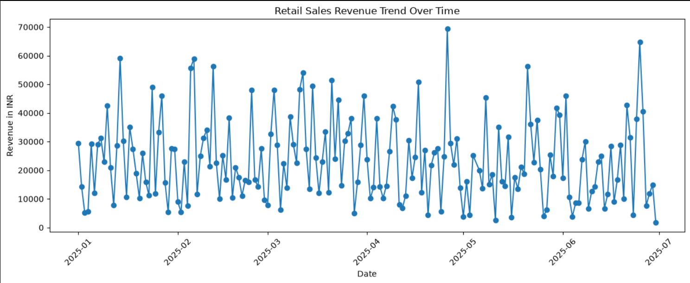
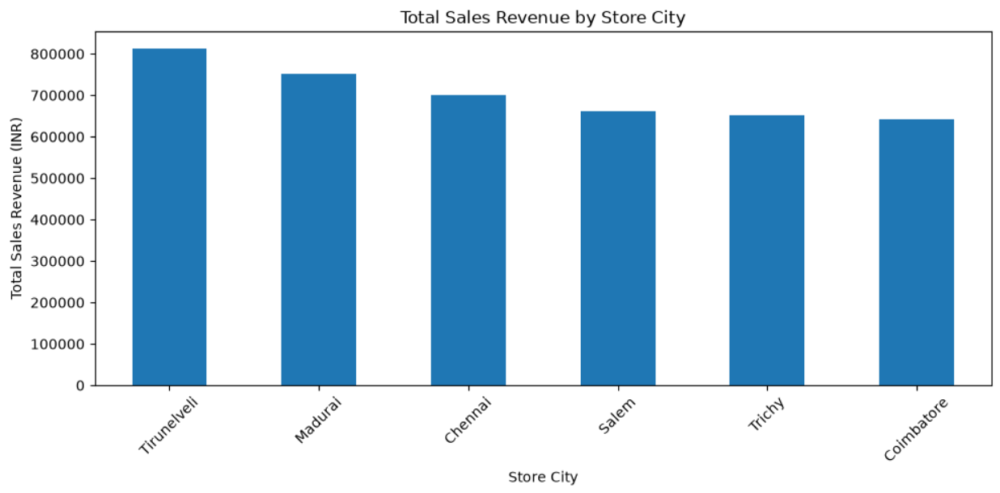
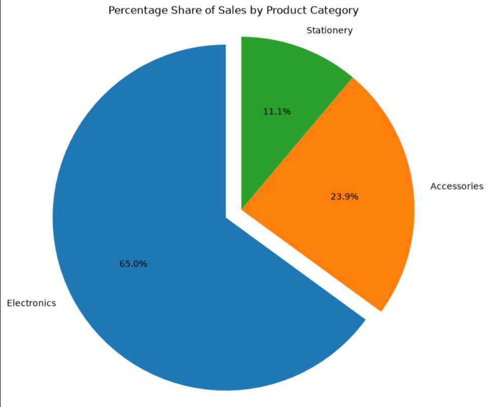
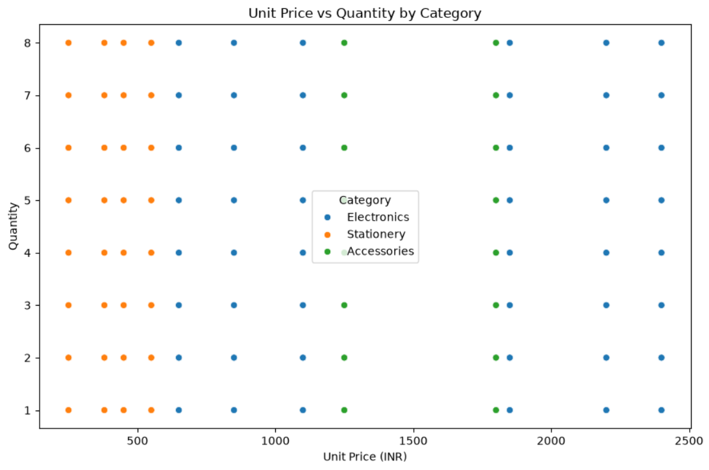
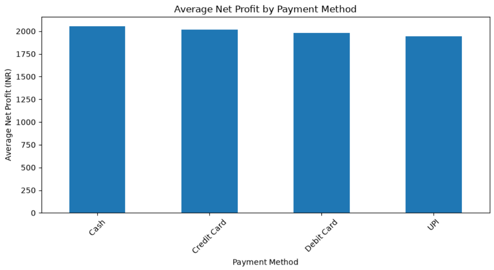

# Retail-Store-Sales-Performance-Analysis

## Project Overview
This project explores retail transaction data to understand sales performance, revenue trends, product-category contribution, store-city performance, and profitability across payment methods. Using Python data analysis and visualization libraries, the notebook performs data inspection, statistical analysis, data transformation, aggregation, and chart generation to extract useful business insights.

The analysis covers 800 retail transactions recorded from January to June 2025, across three product categories and six store cities.

## Key Features

- Dataset inspection and data-type analysis
- Missing-value checks and descriptive statistics
- Revenue calculations and statistical summaries
- Running cumulative revenue calculation
- Filtering transactions by category, city, quantity, and payment method
- High-value order tagging
- Net profit and profit-margin calculation
- Revenue sorting and category-wise profit sorting
- Category-wise revenue and transaction aggregation
- Daily revenue trend analysis
- City-wise total sales revenue comparison
- Product-category revenue share analysis
- Unit price versus quantity analysis by category
- Average net profit comparison by payment method

## Dataset Overview

The dataset contains 800 transactions and 12 columns.
Column	Description
Transaction_ID	Unique transaction identifier
Date	Transaction date
Product_ID	Product identifier
Product_Name	Name of the product
Category	Product category
Unit_Price	Selling price per unit (INR)
Quantity	Number of units sold
Total_Revenue	Revenue generated by the transaction
Cost_Price	Total cost associated with the transaction
Payment_Method	Payment method used
Store_City	City where the sale occurred
Sales_Channel	Channel through which the sale was made

The notebook checks all 12 columns for missing values; the displayed results show no missing values. The analysis identifies 3 product categories and 12 unique product names.

## Key Business Metrics

- Total Transactions: 800
- Total Revenue: ₹4,220,060
- Average Revenue per Transaction: ₹5,275.08
- Median Revenue per Transaction: ₹3,600
- Lowest Transaction Revenue: ₹250
- Highest Transaction Revenue: ₹19,200
- Product Categories: 3
- Unique Products: 12

## Sales and Category Analysis

The category-wise aggregation in the notebook reports:
Product Category	Total Revenue (INR)	Number of Sales
Electronics	₹2,741,300	391
Accessories	₹1,009,050	147
Stationery	₹469,710	262

Electronics contributes the largest share of total revenue, followed by Accessories and Stationery. The category-share chart visualizes this contribution.

## Profitability Analysis

The notebook creates two additional metrics:
- Net Profit: Total_Revenue - Cost_Price
- Profit Margin (%): (Net_Profit / Total_Revenue) * 100
It also compares average net profit across Cash, Credit Card, Debit Card, and UPI payment methods. These calculations help examine transaction profitability and compare payment-method groups.

## Visualizations

The project generates the following charts:
1. Retail Sales Revenue Trend Over Time – daily revenue across the analysis period.
2. Total Sales Revenue by Store City – compares revenue across store cities.
3. Percentage Share of Sales by Product Category – shows each category's contribution to total revenue.
4. Unit Price vs Quantity by Category – explores the relationship between unit price and quantity sold.
5. Average Net Profit by Payment Method – compares average transaction net profit by payment type.

## Technologies Used

- Python – programming language used for the analysis.
- Jupyter Notebook – interactive environment for running and documenting the analysis.

## Libraries Used

Library	Purpose
Pandas	Reading CSV and Excel files, inspecting data, filtering, sorting, grouping, and aggregating transactions.
NumPy	Numerical calculations, array operations, conditional tagging, and statistical summaries.
Matplotlib	Creating line, bar, and pie charts.
Seaborn	Creating the category-based scatter plot.

## Project Files

- Retail_Store_Sales.ipynb – Jupyter Notebook containing the complete analysis and visualizations.
- Retail_Sales_Easy_Project.csv – CSV dataset loaded for the main analysis.
- Retail_Sales_Easy_Project.xlsx – Excel version of the sales data, also read in the notebook.
- profit_by_payment_method.png – chart image saved by the notebook.
Make sure the dataset file paths in the notebook match the location of the CSV and Excel files in your repository.

## How to Run the Project

1. Clone the repository
git clone <your-repository-url>
cd <your-repository-folder>
2. Install the required libraries
pip install pandas numpy matplotlib seaborn openpyxl jupyter
3. Start Jupyter Notebook
jupyter notebook
4. Open and run

Open Retail_Store_Sales.ipynb and run the cells in order. Keep the CSV and Excel dataset files in the expected location, or update the file paths in the notebook.

## Dashboard / Visualization Preview
Add the exported chart images to your repository (for example, in an images/ folder) and use the following Markdown image links:

## Final Conclusion
This retail sales analysis provides a structured view of transaction revenue, category contribution, store-city performance, and profitability. The results show that Electronics is the leading revenue category in the analyzed dataset. By combining data cleaning checks, statistical summaries, derived business metrics, grouping, and visualizations, the project demonstrates how Python can turn raw retail transaction data into insights that support sales monitoring and business decision-making.
